<div align="center">

<!-- Animated Header Banner -->


<!-- Typing Animation -->


<br/>

<!-- Badges row -->


<br/>

<!-- Snake contribution animation -->
<picture>
  <source media="(prefers-color-scheme: dark)" srcset="https://raw.githubusercontent.com/DEATHGATE01/DEATHGATE01/main/dist/github-snake-dark.svg" />
  <source media="(prefers-color-scheme: light)" srcset="https://raw.githubusercontent.com/DEATHGATE01/DEATHGATE01/main/dist/github-snake.svg" />
  
</picture>

</div>

---

<!-- About -->


### 👋 About Me

```yaml
name:       Priyanshu Sharma
location:   India
education:  B.Tech CSE (2023-2027)
            @ BML Munjal University
            CGPA: 6.96 | 12th: 88.6% | 10th: 96%

focus_areas:
  - AI-Driven Automation & LLM Pipelines
  - RAG Systems & Multi-Agent Architectures
  - Full-Stack AI Product Development
  - PDF Intelligence & Document Understanding

currently_building:
  - VidhanAi      — Parliamentary AI (938+ bills, RAG + QLoRA)
  - Aura Search   — AI PDF Search with streaming citations
  - BioLeadIQ     — Explainable biotech lead scoring pipeline
  - secops-agent  — Autonomous security triage (151 tests)

open_to: SDE Internships | AI/ML Roles | Full-Stack Roles
```

<br clear="right"/>

---

<!-- Connect -->
<div align="center">

### 🔗 Connect With Me

[](https://www.linkedin.com/in/priyanshu-sharma-6416a22a4/)
[](https://github.com/DEATHGATE01)
[](mailto:sharmapriyanshu345@gmail.com)
[](https://drive.google.com/file/d/1WRv6slYzn9KeOhKBKIbvlLQSZkpbH8IX/view?usp=drivesdk)

</div>

---

### 🛠️ Tech Stack

<div align="center">

**Languages**

[](https://skillicons.dev)

**Frameworks & Libraries**

[](https://skillicons.dev)

**Tools & DevOps**

[](https://skillicons.dev)

**AI / ML Stack**


**Core CS**


</div>

---

### 💼 Experience

<table>
  <tr>
    <td width="50%" valign="top">
      <h3>🤖 Independent AI Builder</h3>
      
      &nbsp;
      
      <br/><br/>
      <p>Building production-grade AI automation systems: RAG pipelines, multi-agent workflows, document intelligence. 5 key repos with green CI, 151 offline tests on secops-agent, 938+ bills scraped for VidhanAi.</p>
      <p>
        
        
        
        
        
      </p>
    </td>
    <td width="50%" valign="top">
      <h3>🏈 Football Team Captain</h3>
      
      &nbsp;
      
      <br/><br/>
      <p>Led college football team — strategy, coordination, and mentorship. Developed leadership, team dynamics, and performance under pressure — directly transferable to engineering team lead roles.</p>
      <p>
        
        
        
      </p>
    </td>
  </tr>
</table>

---

### 🚀 Featured Projects

<table>
  <tr>
    <td width="50%" valign="top">
      <h3>🏛️ VidhanAi — Parliamentary AI Platform</h3>
      
      <p>Gen AI platform scraping, analyzing & simplifying <strong>938+ Indian parliamentary bills (1952–2024)</strong> using RAG pipeline + QLoRA fine-tuned LLMs. <strong>190 bills + 50 acts released</strong>, <strong>2,226 ChromaDB chunks</strong>, <strong>37 ministries</strong>. Hybrid retrieval + reranking with citation-backed responses.</p>
      <p>
        
        
        
        
        
      </p>
      <a href="https://github.com/DEATHGATE01/VidhanAi">
        
      </a>
    </td>
    <td width="50%" valign="top">
      <h3>🔍 Aura Search — AI PDF Search Chat</h3>
      
      <p>AI-powered PDF search with <strong>streaming responses</strong> and <strong>page-accurate citations</strong>. FastAPI backend with LangGraph agent, SSE streaming, async job queue. Next.js frontend with real-time chat UI. CI passing with pytest + ruff.</p>
      <p>
        
        
        
        
        
      </p>
      <a href="https://github.com/DEATHGATE01/Aura-Search">
        
      </a>
    </td>
  </tr>
  <tr>
    <td width="50%" valign="top">
      <h3>🧬 BioLeadIQ — Biotech Lead Intelligence</h3>
      
      <p>Explainable lead-intelligence pipeline scoring biotech outreach targets from LinkedIn, PubMed & funding data. Rule-based composite scoring (role fit 30%, scientific intent 40%, funding 20%, location 10%). CSV + Google Sheets export. CI passing with pytest + ruff.</p>
      <p>
        
        
        
        
      </p>
      <a href="https://github.com/DEATHGATE01/BioLeadIQ">
        
      </a>
    </td>
    <td width="50%" valign="top">
      <h3>🛡️ secops-agent — Autonomous Security Triage</h3>
      
      <p>Xiarch take-home: autonomous security triage agent with <strong>151 offline deterministic tests</strong>. Two-phase plan/act architecture, ScriptedLLM for reproducibility, human-gated escalation, JSONL audit trail. Production-grade agent skeleton.</p>
      <p>
        
        
        
        
      </p>
      <a href="https://github.com/DEATHGATE01/secops-agent">
        
      </a>
    </td>
  </tr>
  <tr>
    <td width="50%" valign="top">
      <h3>📈 TradingView Idea Automation</h3>
      
      <p>AI-agent-driven n8n workflow that enriches and auto-posts trading ideas. LLM-powered analysis, automated publishing pipeline. CI passing with Jest tests.</p>
      <p>
        
        
        
      </p>
      <a href="https://github.com/DEATHGATE01/TradingView_Idea-N8N">
        
      </a>
    </td>
  </tr>
</table>

---

### 📊 GitHub Stats

<div align="center">




</div>

<div align="center">



</div>

---

### 🌱 GitHub Profile Summary

<div align="center">


</div>

---

### 🎖️ Achievements

| 🏅 | Achievement |
|---|---|
| 🏛️ | **VidhanAi** — 938+ bills scraped, 2,226 ChromaDB chunks, QLoRA fine-tuning (BLEU +2.62, ROUGE-1 +0.024) |
| 🛡️ | **secops-agent** — 151 offline deterministic tests, human-gated escalation, JSONL audit trail |
| 🔍 | **Aura Search** — Streaming PDF search with page-accurate citations, SSE, async job queue |
| 🧬 | **BioLeadIQ** — Explainable composite scoring (role 30%, scientific 40%, funding 20%, location 10%) |
| 📈 | **TradingView Automation** — n8n + LLM agent for automated trading idea enrichment |
| 🏈 | **Football Captain** — BML Munjal University team captain (leadership, strategy, mentorship) |
| 🎓 | **B.Tech CSE 2027** — BML Munjal University (CGPA 6.96, 12th 88.6%, 10th 96%) |

---

<div align="center">


</div>